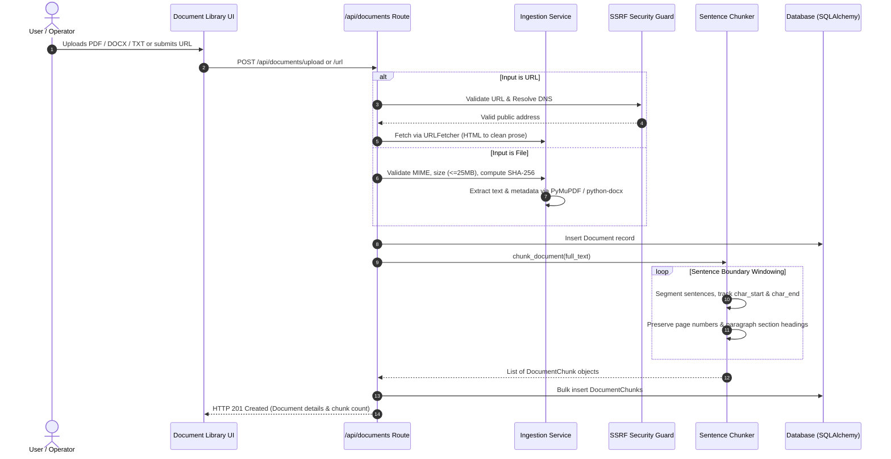
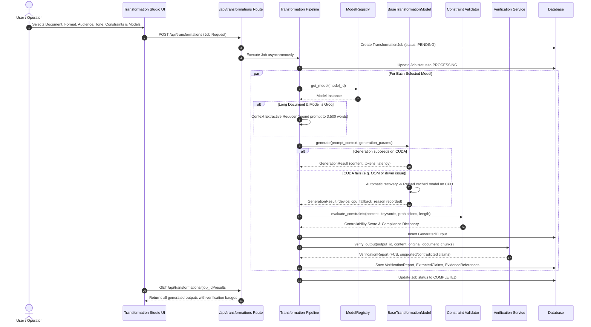
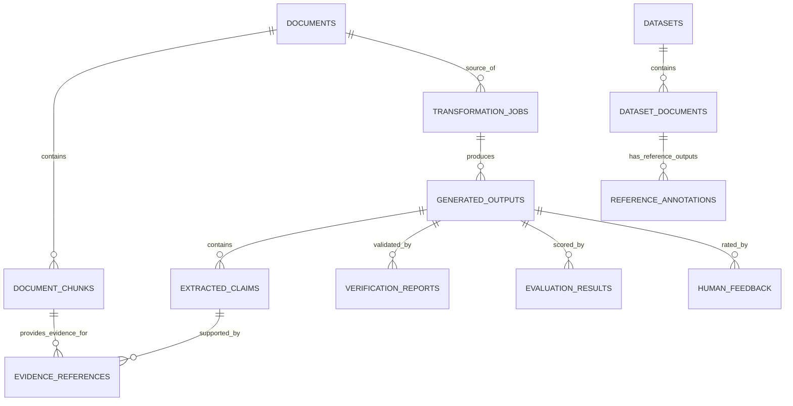
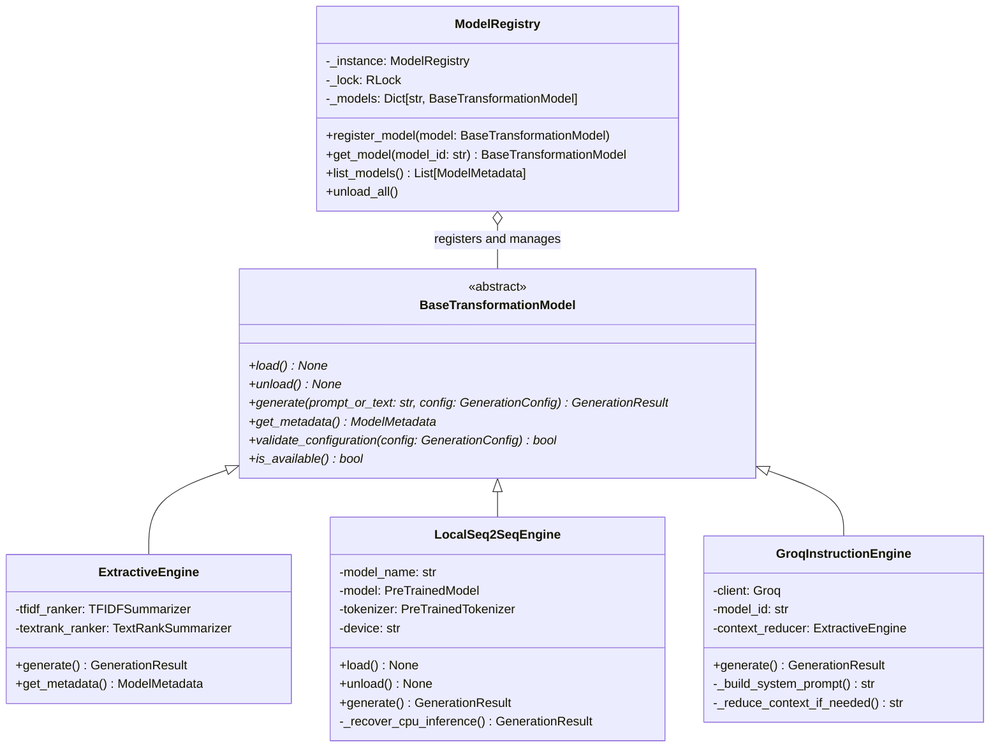
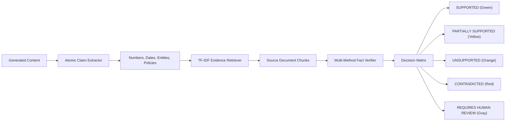
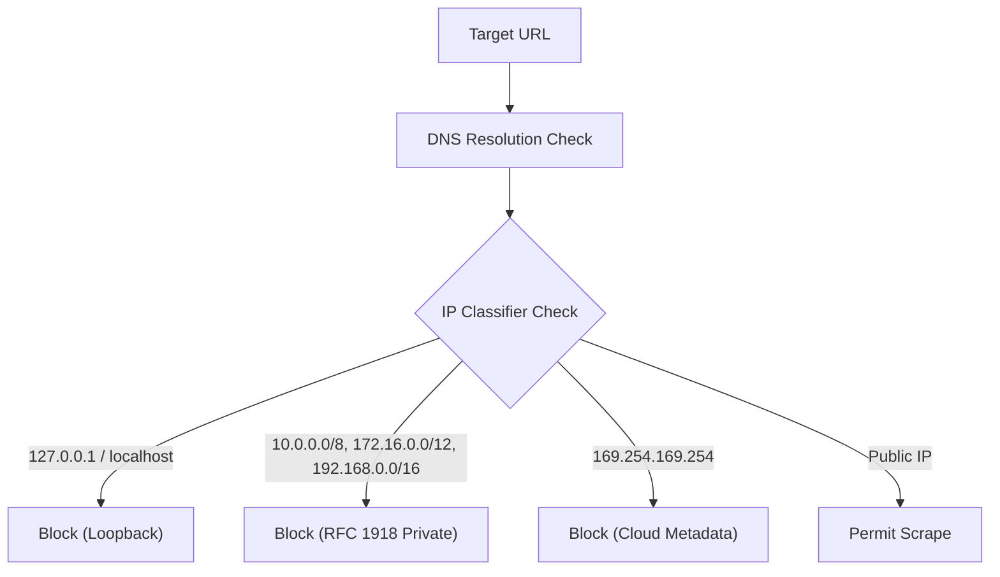

# ARCHITECTURE.md — System Architecture & Design Specification
**Gen AI Platform for Automated Content Transformation (ACTP) — Smart India Hackathon 2026**

---

## 1. System Overview & Core Mission

Organizations repeatedly transform a single source document into different communication formats for diverse audiences:
1. **Executive Summary** for senior leadership and decision makers.
2. **Public Advisory** for citizens with actionable precautions and facts.
3. **Social Media Posts** for LinkedIn and X (formerly Twitter) with appropriate conciseness and hashtags.
4. **FAQ** for citizen and operational query resolution with grounded evidence.

### Core Product Principle
> **One source of truth. Multiple audiences. Multiple communication formats. Verifiable factual accuracy.**

The platform implements, benchmarks, and provides transparent comparisons across three distinct generation paradigms:
1. **Extractive Summarisation (Local Baseline)**: TF-IDF & TextRank sentence graph ranking. Verbatim, zero-hallucination baseline.
2. **Transformer Seq2Seq Generation (Local Neural)**: Hugging Face `google/flan-t5-base` & `facebook/bart-base` running locally on GPU/CPU with dynamic VRAM management and CUDA-to-CPU failure recovery.
3. **Instruction-Tuned LLM (Cloud High-Throughput)**: Groq SDK inference (`openai/gpt-oss-120b`) with bounded extractive context reduction for long documents, exponential backoff, and token/cost telemetry.

---

## 2. High-Level Architecture Diagram

```mermaid
flowchart TD
    subgraph Client["Presentation Layer (Next.js 14 / TypeScript)"]
        UI_Dash["Dashboard (/)"]
        UI_Doc["Document Library (/documents)"]
        UI_Trans["Transformation Studio (/transform)"]
        UI_Review["Review & Traceability (/review)"]
        UI_Lab["Model Laboratory (/models)"]
        UI_Eval["Evaluation Dashboard (/evaluation)"]
        UI_Dataset["Dataset Management (/datasets)"]
    end

    subgraph API["API Gateway & Dispatch Layer (FastAPI 0.115)"]
        R_Health["/api/health"]
        R_Doc["/api/documents"]
        R_Trans["/api/transformations"]
        R_Models["/api/models"]
        R_Verif["/api/verification"]
        R_Eval["/api/evaluations"]
        R_Data["/api/datasets"]
        R_Exp["/api/exports"]
        R_Ver["/api/versioning"]
    end

    subgraph CoreServices["Application Services & Pipelines"]
        S_Ingest["Document Ingestion & Chunking (PyMuPDF, python-docx, Trafilatura)"]
        S_SSRF["SSRF Defense Guard (DNS & Private IP Filter)"]
        S_TransPipeline["Transformation Orchestration Pipeline"]
        S_Constraint["Constraint Validator (Keywords, Length, Prohibitions)"]
        S_VerifEngine["Factual Verification Engine (Claim Extractor, Evidence Retriever, Verifier)"]
        S_EvalEngine["Evaluation Engine (ROUGE-1/2/L, Coverage, FCS, Controllability)"]
        S_Export["Multi-Format Exporter (ReportLab PDF, python-docx DOCX, MD, TXT)"]
        S_Version["Output Versioning & Human Feedback Service"]
    end

    subgraph MLRegistry["AI Model Layer (Common Interface)"]
        MR["Thread-Safe Singleton ModelRegistry"]
        M_Extractive["Extractive Engine (TF-IDF Centroid & TextRank PageRank)"]
        M_T5["Local Seq2Seq (FLAN-T5-base)"]
        M_BART["Local Seq2Seq (BART-base)"]
        M_Groq["Instruction LLM (Groq API / Context Bounding)"]
    end

    subgraph Storage["Persistence & Artifacts"]
        DB[("Dual-Mode Database: PostgreSQL 16 / SQLite Fallback")]
        DiskStorage["Local File Storage (/storage/uploads, /storage/exports)"]
        HF_Cache["HuggingFace Cache (/models_cache)"]
    end

    Client --> API
    API --> CoreServices
    CoreServices --> MLRegistry
    CoreServices --> Storage
    MLRegistry --> HF_Cache
```



---

## 3. Complete Project Directory Structure

```
Automated Content Transformation Platform/
├── .env                                  # Active credentials (DB, Groq, HF, Ports)
├── .env.example                          # Configuration template
├── .gitignore                            # Excludes venv, node_modules, cache, credentials
├── AGENTS.md                             # Multi-agent protocol & development guidelines
├── ARCHITECTURE.md                       # Complete system architecture specification
├── COMPLETION_PLAN.md                    # Roadmap & execution checklist
├── DECISIONS.md                          # Architecture Decision Records (ADRs)
├── docker-compose.yml                    # Multi-container orchestration (PostgreSQL, backend, frontend)
├── HANDOFF.md                            # Session continuity state and diagnostic history
├── pytest.ini                            # Pytest configuration
├── README.md                             # Master project overview
├── TASKS.md                              # Phase-by-phase task tracking (Phases 0-8)
│
├── backend/                              # Python 3.13+ FastAPI Application
│   ├── alembic.ini                       # Migration configuration
│   ├── requirements.txt                  # Python package dependencies
│   ├── content_transformer.db            # Local SQLite database (auto-fallback)
│   ├── models_cache/                     # Local Hugging Face model checkpoints (FLAN-T5, BART)
│   ├── storage/                          # File persistence (uploads/ and exports/)
│   │
│   ├── app/                              # Application Package
│   │   ├── main.py                       # FastAPI factory, lifespan, CORS, and routers
│   │   ├── api/routes/                   # 9 Route Handlers (health, documents, transformations, etc.)
│   │   ├── core/                         # Config, domain exceptions, structured logging, SSRF guard
│   │   ├── data/                         # Built-in benchmark seed dataset (curated_benchmark.json)
│   │   ├── db/                           # Database session, base declarative model, 10 ORM models
│   │   ├── ml/                           # AI Model Layer: base interface, registry, 3 model engines
│   │   ├── pipelines/                    # Transformation orchestration pipeline
│   │   ├── schemas/                      # Pydantic v2 validation contracts
│   │   └── services/                     # Ingestion, chunking, verification, evaluation, export, versioning
│   │
│   └── tests/                            # Comprehensive Pytest test suite (7 test suites)
│
├── frontend/                             # Next.js 14+ TypeScript Client Application
│   ├── package.json                      # Next.js, React, Tailwind, Recharts, Lucide
│   ├── tsconfig.json                     # Strict TypeScript configuration
│   ├── tailwind.config.ts                # Styling design tokens
│   ├── playwright.config.ts              # E2E test configuration
│   ├── src/
│   │   ├── app/                          # Next.js App Router (7 operational views)
│   │   │   ├── page.tsx                  # Dashboard
│   │   │   ├── documents/page.tsx        # Document Library
│   │   │   ├── transform/page.tsx        # Transformation Studio
│   │   │   ├── review/page.tsx           # Review & Traceability Workspace
│   │   │   ├── models/page.tsx           # Model Laboratory
│   │   │   ├── evaluation/page.tsx       # Evaluation Dashboard
│   │   │   └── datasets/page.tsx         # Dataset Management
│   │   ├── components/layout/            # Sidebar and Header components
│   │   └── lib/utils.ts                  # Classname utilities
│   └── tests/                            # Component and Playwright E2E tests
│
├── sample_data/                          # Benchmark dossiers & reference outputs
└── docs/                                 # 12 comprehensive architecture and operational guides
```

---

## 4. End-to-End Execution Sequences

### 4.1 Ingestion & Traceable Chunking Sequence


### 4.2 Multi-Model Transformation Sequence


---

## 5. Database Schema & Entity Relationships



Primary tables:
- `documents`: Source file metadata, hash, extracted text, raw file path.
- `document_chunks`: Fine-grained chunk units with page, section, and character offsets.
- `transformation_jobs`: Execution job state, target format, audience, tone, constraints.
- `generated_outputs`: Model outputs, versioning, generation parameters, latency, tokens.
- `extracted_claims`: Atomic claims parsed from outputs.
- `evidence_references`: Mappings between claims and supporting source chunks.
- `verification_reports`: Aggregated verification scores and summaries.
- `evaluation_results`: Granular ROUGE, coverage, consistency, and controllability metrics.
- `human_feedback`: Likert-scale human ratings (accuracy, completeness, readability, suitability).
- `datasets` & `reference_annotations`: Golden benchmarks for repeatable comparisons.

---

## 6. AI Model Layer & Registry Pattern

### 6.1 Class Hierarchy


### 6.2 Architectural Highlights
1. **Thread-Safe Singleton Registry**: Uses `threading.RLock` to eliminate race conditions during concurrent multi-model executions.
2. **CUDA Failure Auto-Recovery**: If a GPU inference fails, `LocalSeq2SeqEngine` frees GPU cache, reloads the model on `cpu`, retries generation, and annotates the fallback reason in output metadata.
3. **Context Bounding for Cloud LLMs**: Long documents (>3,500 words) are reduced using an extractive ranking pass before prompting Groq, avoiding TPM limits while preserving the complete source for claim verification.

---

## 7. Factual Verification & Hallucination Detection



### Mathematical Formula for Factual Consistency Score (FCS)
$$\text{FCS} = \frac{N_{\text{supported}} + 0.5 \cdot N_{\text{partially\_supported}}}{N_{\text{total\_claims}}}$$

---

## 8. Five Evaluation Dimensions

1. **Text Similarity**: ROUGE-1, ROUGE-2, ROUGE-L, and BERTScore token similarity.
2. **Content Coverage**: Key Fact Recall, Named Entity Recall, and Numerical Fact Recall against gold annotations.
3. **Factual Grounding**: Factual Consistency Score (FCS).
4. **Controllability**: Compliance with word count budgets, required keywords, and prohibited terms.
5. **Computational Efficiency**: Latency (ms), token throughput, memory usage (MB), and estimated cost ($).

---

## 9. Security & SSRF Defense



- **SSRF Protection**: Private subnets and cloud metadata endpoints are strictly denied.
- **Server-Side API Keys**: Groq and Hugging Face secrets remain exclusively on the backend.
- **Prompt Injection Defense**: Source chunks are isolated as pure data within `<source_document>` delimiters.
