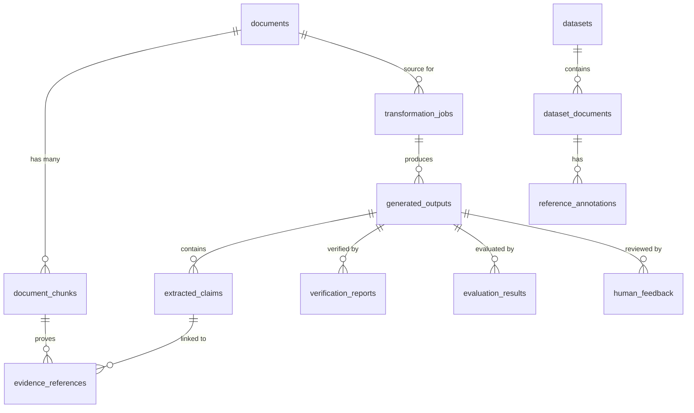

# DATABASE_SCHEMA.md — Relational Schema & Entity Specifications
**Smart India Hackathon 2026 — Gen AI Platform for Automated Content Transformation**

---

## 1. Overview
The database layer uses **SQLAlchemy 2.0 Declarative ORM** with dual-mode operational support:
- **Production Mode**: PostgreSQL 16 (via `postgresql+psycopg`).
- **Development / Demo Fallback**: SQLite (via `sqlite+aiosqlite` or standard `sqlite://`).

To ensure total portability between PostgreSQL and SQLite without dialect conflicts:
- Primary keys are UUIDs stored as `String(36)`.
- Flexible metadata, parameters, and verification details are stored as standard `JSON`.
- Timestamps are UTC `DateTime` with default `datetime.utcnow`.

---

## 2. Entity Relationship Diagram (ERD)

---

## 3. Table Definitions

### 3.1 `documents`
Stores original ingested documents and extracted text.
| Column | Type | Constraints | Description |
|---|---|---|---|
| `id` | String(36) | PK | Unique UUID v4 identifier |
| `title` | String(255) | NOT NULL | Document title or original filename |
| `source_type` | String(32) | NOT NULL | `FILE_UPLOAD`, `PASTED_TEXT`, `URL` |
| `file_type` | String(16) | NULL | `pdf`, `docx`, `txt`, `html` |
| `file_size_bytes` | Integer | NULL | Byte count of original document |
| `file_hash` | String(64) | INDEX | SHA-256 checksum of raw content |
| `raw_file_path` | String(512) | NULL | Local storage path |
| `source_url` | String(1024) | NULL | Original URL if ingested via web |
| `total_pages` | Integer | DEFAULT 1 | Total page count |
| `total_characters`| Integer | NOT NULL | Total clean character count |
| `total_words` | Integer | NOT NULL | Total clean word count |
| `cleaned_text` | Text | NOT NULL | Cleaned, normalized full document text |
| `meta_info` | JSON | DEFAULT {} | Extracted author, publisher, date metadata |
| `created_at` | DateTime | NOT NULL | Ingestion timestamp |
| `updated_at` | DateTime | NOT NULL | Last update timestamp |

### 3.2 `document_chunks`
Stores discrete sentence-bounded text segments for fine-grained retrieval and factual attribution.
| Column | Type | Constraints | Description |
|---|---|---|---|
| `id` | String(36) | PK | Chunk UUID |
| `document_id` | String(36) | FK(documents.id) | Parent document |
| `chunk_index` | Integer | NOT NULL | 0-based sequence order in document |
| `page_number` | Integer | NULL | Physical page in source document |
| `section_heading` | String(255) | NULL | Heading or chapter title |
| `char_start` | Integer | NOT NULL | Character offset start in `cleaned_text` |
| `char_end` | Integer | NOT NULL | Character offset end in `cleaned_text` |
| `text` | Text | NOT NULL | Segment text |
| `token_count` | Integer | NOT NULL | Approximate token count |
| `created_at` | DateTime | NOT NULL | Timestamp |

### 3.3 `transformation_jobs`
Represents an asynchronous transformation task.
| Column | Type | Constraints | Description |
|---|---|---|---|
| `id` | String(36) | PK | Job UUID |
| `document_id` | String(36) | FK(documents.id) | Source document |
| `format_type` | String(32) | NOT NULL | `EXECUTIVE_SUMMARY`, `PUBLIC_ADVISORY`, `SOCIAL_POST`, `FAQ` |
| `audience` | String(64) | NOT NULL | E.g. `Senior Management`, `General Public` |
| `tone` | String(64) | NOT NULL | E.g. `Formal`, `Conversational` |
| `length_target`| String(32) | NOT NULL | `SHORT`, `MEDIUM`, `DETAILED`, `CUSTOM` |
| `custom_word_limit` | Integer | NULL | Numerical word ceiling |
| `required_keywords` | JSON | DEFAULT [] | List of terms that must be present |
| `prohibited_terms` | JSON | DEFAULT [] | List of terms that must not appear |
| `status` | String(32) | NOT NULL | `PENDING`, `PROCESSING`, `COMPLETED`, `FAILED` |
| `error_message`| Text | NULL | Error diagnostics if failed |
| `created_at` | DateTime | NOT NULL | Creation timestamp |
| `completed_at` | DateTime | NULL | Completion timestamp |

### 3.4 `generated_outputs`
Stores the transformed content, model configuration, and revision history.
| Column | Type | Constraints | Description |
|---|---|---|---|
| `id` | String(36) | PK | Output UUID |
| `job_id` | String(36) | FK(transformation_jobs.id) | Parent job |
| `model_id` | String(128) | NOT NULL | E.g. `extractive/textrank`, `flan-t5-base`, `groq/llama-3.3` |
| `model_provider` | String(64) | NOT NULL | `LOCAL_EXTRACTIVE`, `LOCAL_SEQ2SEQ`, `GROQ` |
| `version` | Integer | DEFAULT 1 | Output iteration index |
| `parent_output_id` | String(36) | NULL | Prior version if edited |
| `content` | Text | NOT NULL | Generated markdown/text |
| `word_count` | Integer | NOT NULL | Actual word count |
| `generation_latency_ms` | Float | NOT NULL | Wall-clock execution time |
| `input_tokens` | Integer | DEFAULT 0 | Prompt/input token count |
| `output_tokens` | Integer | DEFAULT 0 | Generated token count |
| `estimated_cost_usd` | Float | DEFAULT 0.0 | Estimated inference cost |
| `is_approved` | Boolean | DEFAULT FALSE | Human approval flag |
| `created_at` | DateTime | NOT NULL | Generation timestamp |

### 3.5 `extracted_claims` & `evidence_references`
Stores atomic factual claims and their bidirectional mappings to source chunks.
| Column (`extracted_claims`) | Type | Description |
|---|---|---|
| `id` | String(36) (PK) | Claim UUID |
| `output_id` | String(36) (FK) | Target generated output |
| `claim_text` | Text | Atomic factual claim |
| `claim_type` | String(32) | `NUMERICAL`, `DATE`, `ENTITY`, `POLICY`, `GENERAL` |
| `verification_status` | String(32) | `SUPPORTED`, `PARTIALLY_SUPPORTED`, `UNSUPPORTED`, `CONTRADICTED`, `REQUIRES_HUMAN_REVIEW` |
| `confidence_score` | Float | Score from 0.0 to 1.0 |
| `explanation` | Text | Rationale for verification status |

| Column (`evidence_references`) | Type | Description |
|---|---|---|
| `id` | String(36) (PK) | Reference UUID |
| `claim_id` | String(36) (FK) | Parent claim |
| `chunk_id` | String(36) (FK) | Supporting source chunk |
| `relevance_score` | Float | Semantic similarity / overlap score |
| `evidence_text` | Text | Snippet from chunk serving as proof |

### 3.6 `verification_reports`
Aggregated factuality audit per generated output.
| Column | Type | Description |
|---|---|---|
| `id` | String(36) (PK) | Report UUID |
| `output_id` | String(36) (FK) | Unique FK to `generated_outputs` |
| `total_claims` | Integer | Count of extracted claims |
| `supported_claims` | Integer | Supported claim count |
| `partially_supported` | Integer | Partially supported claim count |
| `unsupported_claims` | Integer | Unsupported claim count |
| `contradicted_claims` | Integer | Contradicted claim count |
| `factual_consistency_score` | Float | $\frac{N_{\text{supported}} + 0.5 \cdot N_{\text{partially\_supported}}}{N_{\text{total}}}$ |
| `summary` | Text | High-level factuality assessment |
| `created_at` | DateTime | Timestamp |

### 3.7 `evaluation_results`
Stores automated comparative benchmark metrics.
| Column | Type | Description |
|---|---|---|
| `id` | String(36) (PK) | Metric UUID |
| `output_id` | String(36) (FK) | Target output |
| `rouge_1_f1` | Float | ROUGE-1 F1 score |
| `rouge_2_f1` | Float | ROUGE-2 F1 score |
| `rouge_l_f1` | Float | ROUGE-L F1 score |
| `bert_score_f1` | Float | BERTScore semantic F1 |
| `key_fact_coverage` | Float | Ratio of gold key facts retained |
| `entity_coverage` | Float | Named entity preservation ratio |
| `numerical_coverage`| Float | Numbers preserved ratio |
| `controllability_score` | Float | Compliance with length, tone, keywords (0.0 - 1.0) |
| `created_at` | DateTime | Timestamp |

### 3.8 `datasets`, `dataset_documents`, `reference_annotations`
Stores benchmark corpora (e.g. NITI Aayog, WHO publications) and ground-truth references.
